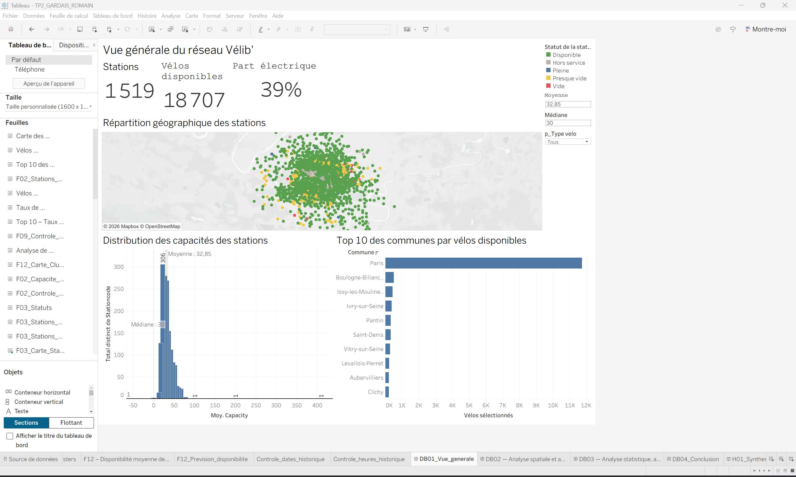
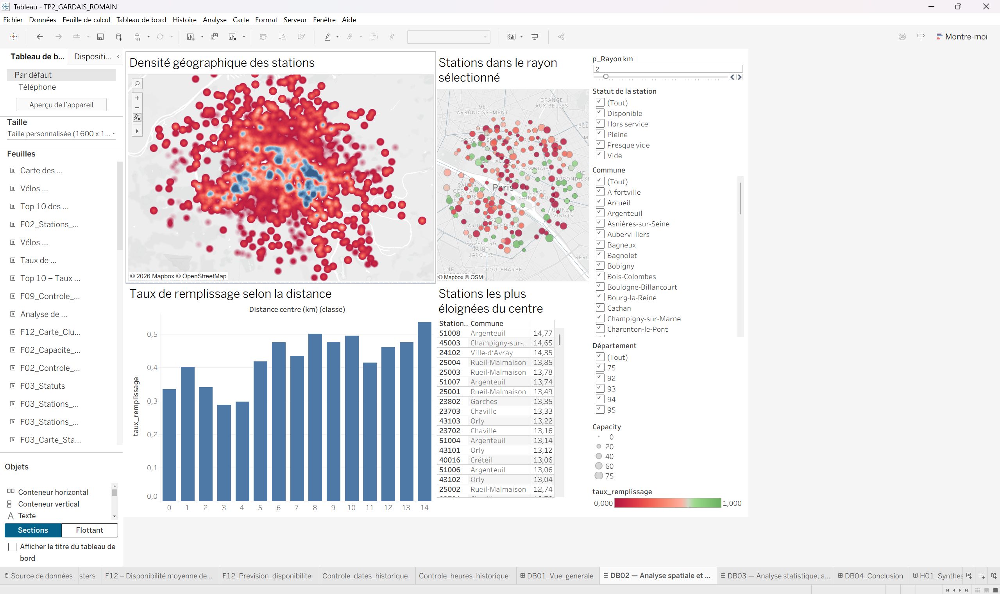
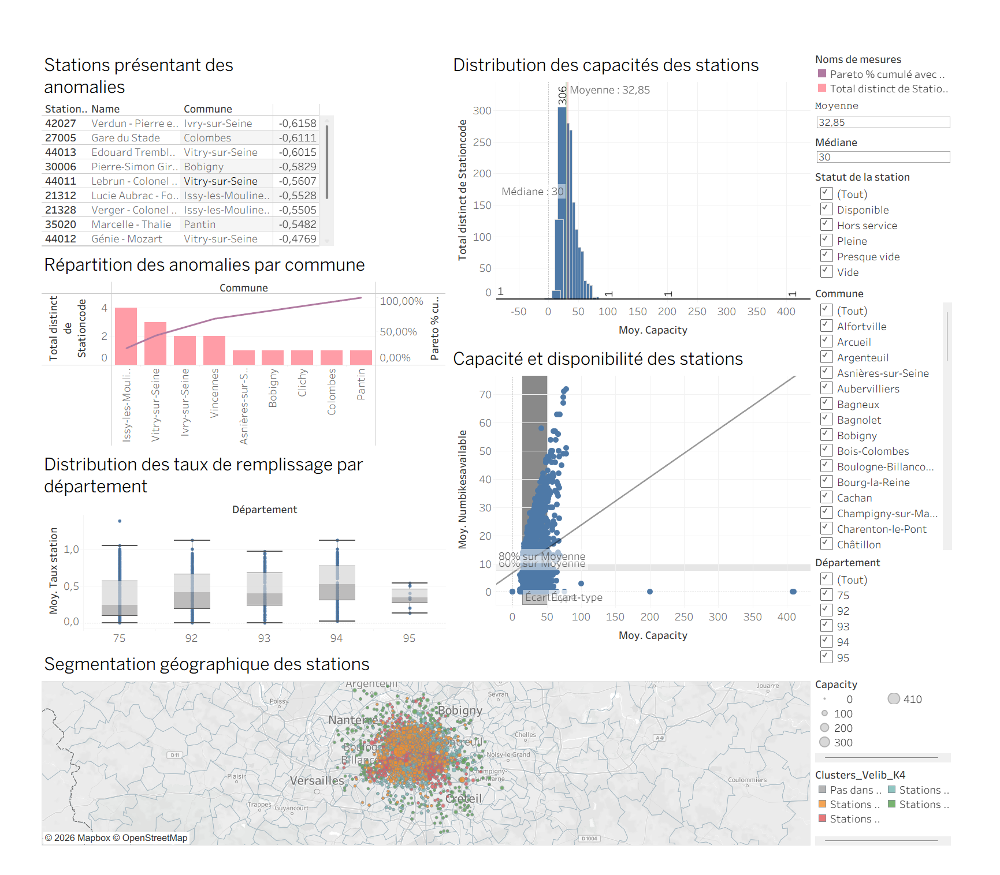
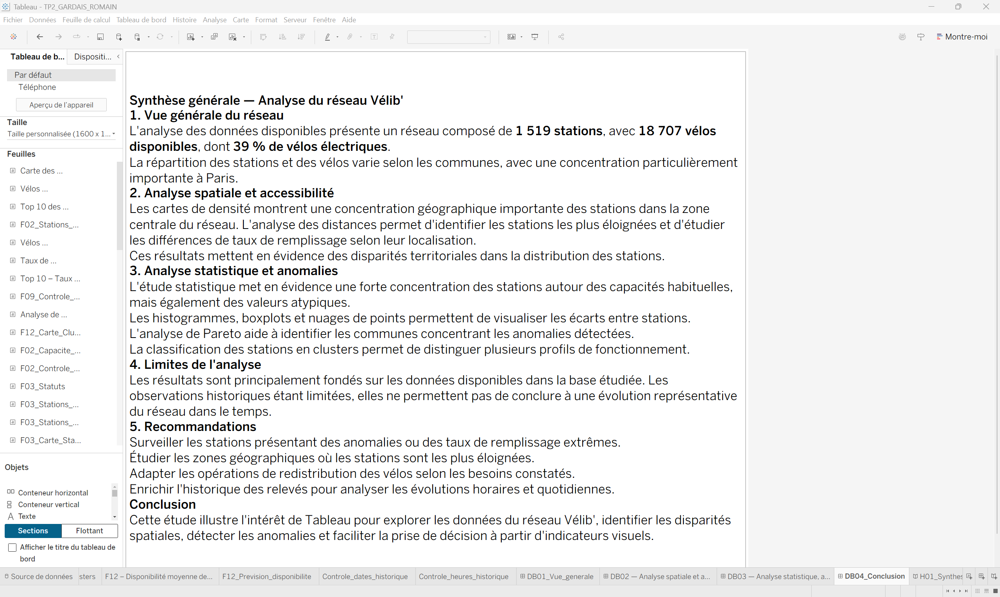

# TP2 – Analyse des données Vélib' avec Python, MySQL, SQL et Tableau

## Présentation du projet

Ce projet a été réalisé dans le cadre d'un travail pratique de Data Analysis consacré à l'étude du réseau de vélos en libre-service Vélib'.

L'objectif est d'exploiter les données des stations afin d'analyser leur répartition géographique, leur capacité, la disponibilité des vélos mécaniques et électriques ainsi que les disparités entre stations.

Le projet couvre plusieurs étapes d'une chaîne de traitement des données : collecte, stockage, interrogation SQL, analyse statistique et visualisation interactive.

## Technologies utilisées

| Technologie | Utilisation |
|---|---|
| Python | Collecte et importation des données |
| MySQL | Stockage des informations sur les stations |
| SQL | Interrogation, contrôle et analyse des données |
| Tableau Desktop | Visualisation, tableaux de bord et analyses |
| GitHub | Versionnement et partage des livrables |

## Organisation du dépôt

```text
TP2-Velib-Data-Analysis/
├── python/
│   ├── collecte_historique.py
│   ├── import_velib.py
│   ├── test_mysql.py
│   └── README.md
├── sql/
│   ├── Requete SQL TP2 GARDAIS Romain.sql
│   └── README.md
├── tableau/
│   ├── TP2_GARDAIS_ROMAIN.twbx
│   └── README.md
├── rapport/
│   ├── Compte_rendu_TP2_Velib_Tableau_SQL_GARDAIS_ROMAIN(1).pdf
│   └── README.md
├── captures/
│   ├── dashboard_general.png
│   ├── analyse_spatiale.png
│   ├── clusters_velib.png
│   ├── conclusion.png
│   └── README.md
└── README.md
```

## Méthodologie

### 1. Collecte et préparation des données

Utilisation de scripts Python pour récupérer les informations relatives aux stations Vélib', importer les données et constituer un historique des relevés.

### 2. Stockage et exploitation SQL

Exploitation d'une base MySQL pour organiser et interroger les informations sur les stations et leurs disponibilités.

Les requêtes SQL utilisées sont disponibles dans le dossier `sql/`.

### 3. Analyse et visualisation avec Tableau

Création de feuilles d'analyse, de cartes géographiques et de tableaux de bord permettant notamment :

- L'étude de la disponibilité des vélos mécaniques et électriques.
- L'analyse spatiale des stations.
- La comparaison des capacités et des disponibilités.
- L'identification de stations présentant des situations particulières.
- L'exploration de regroupements de stations par clustering.
- La réalisation de classements dynamiques et d'indicateurs statistiques.

### 4. Synthèse et restitution

Création de tableaux de bord et d'un compte rendu documentant les traitements, les visualisations et les résultats obtenus.

## Aperçu des visualisations

### Tableau de bord général



### Analyse spatiale



### Analyse des clusters



### Tableau de bord de conclusion



## Livrables

**Classeur Tableau :** [Ouvrir le classeur TP2_GARDAIS_ROMAIN.twbx](tableau/TP2_GARDAIS_ROMAIN.twbx)

**Requêtes SQL :** [Consulter le script SQL](sql/Requete%20SQL%20TP2%20GARDAIS%20Romain.sql)

**Scripts Python :** [Accéder au dossier Python](python/)

**Compte rendu :** [Consulter le rapport PDF](rapport/Compte_rendu_TP2_Velib_Tableau_SQL_GARDAIS_ROMAIN%281%29.pdf)

## Limites de l'analyse

Les résultats dépendent de la qualité, de la couverture temporelle et de la disponibilité des données collectées.

Les analyses historiques doivent être interprétées en tenant compte du nombre de relevés et des éventuelles irrégularités de collecte.

Le classeur Tableau empaqueté peut nécessiter une configuration de connexion à MySQL selon les ressources intégrées.

## Auteur

Projet réalisé par **Romain Gardais** dans le cadre d'une formation Data Analyst.

## Objectif pédagogique

Mettre en pratique les principales étapes d'un projet décisionnel, depuis la collecte et l'exploitation des données jusqu'à leur restitution sous forme de visualisations interactives.
